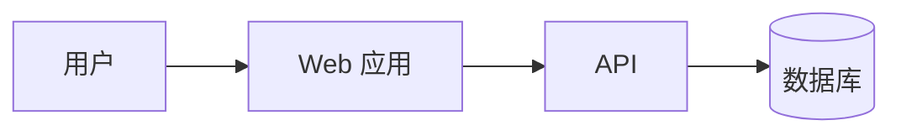
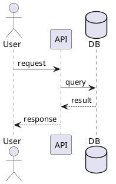
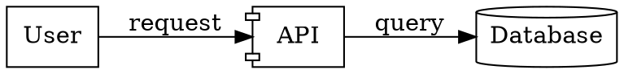
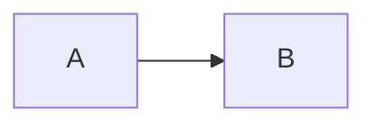

# Software diagrams as code

用“先澄清模型，再确定交付契约，选择 DSL，生成单一来源源码，最后渲染和验证”的流程绘制软件工程图。下文把唯一可编辑的模型文件或 Markdown 代码块称为规范源码（canonical source），把由它生成的 SVG/PNG/PDF 称为渲染产物（rendered outputs）。源码和渲染产物是否发布由发布配置（publication profile）决定；用户明确的文件、提交和发布要求优先于本 skill 的默认值。

## 路径边界

把 `skillRoot` 定义为本 `SKILL.md` 所在目录。若 skill 安装在宿主项目的 `.agents/skills/software-diagrams/`，则 `skillRoot` 就是 `<project>/.agents/skills/software-diagrams/`。本 skill 的 `package.json`、`node_modules/`、`tools/` 和 `scripts/` 都属于 `skillRoot`；宿主项目的图源、文档和渲染产物按项目约定存放，skill 的依赖不要写入宿主项目根目录。

运行 `npm ci`、bootstrap 或本 skill 的 gallery 脚本时，必须以 `skillRoot` 为工作目录或调用其中的脚本。不要把宿主项目的 `tools/`、`node_modules/` 或其他 skill 的目录当作本 skill 的依赖目录，也不要把本 skill 的依赖写入宿主项目根目录。

宿主安装和平台差异请按需阅读 [references/compatibility.md](references/compatibility.md)。`SKILL.md` 是跨模型的核心工作流；`agents/openai.yaml`、`CLAUDE.md` 和 `AGENTS.md` 只是不同宿主的入口或元数据，不要复制出多份独立工作流。

项目级交付、Git 安全、manifest 和收尾报告的详细模板见 [references/project-workflow.md](references/project-workflow.md)。需要时再读取，不要把它当成宿主指令。

## 工作流

1. **分离请求和约束**
   - 把用户要交付的结果与 `AGENTS.md`、宿主提示、skill 文档和工具输出分开记录；这些约束不能自动变成用户要求。
   - 识别用户是否同时指定了目录、文件类型、Git 跟踪范围、提交方式或是否保留本地文件。没有指定时，使用下面的交付契约并说明假设。
   - 不要因为任务涉及图表就自动创建完整文档体系、工具链或多个 DSL；先从最小范围开始。
2. **识别图的目的和受众**
   - 先确认要表达的是结构、行为、数据、部署、流程还是项目计划。
   - 确定抽象层级：系统上下文、容器、组件、类、实例或代码级细节。
   - 记录方向、布局、主题、语言、输出格式、尺寸和是否需要可编辑源文件。
3. **确定交付契约**
   - 在写文件前建立一张简短映射表：图名、目的、受众、canonical source、rendered outputs、嵌入位置、是否发布到 Git。独立交付可以没有 `documents`，但必须写明交付目的和输出位置。
   - 对每张图选择一个 canonical source：独立 DSL 文件或 Markdown 内嵌代码块。另一种形式只能由 canonical source 生成，不能手工复制维护。
   - 使用 [references/project-workflow.md](references/project-workflow.md) 中的 publication profile：`tracked-source`、`local-source/published-artifacts` 或 `local-only-preview`。不要自造同义名称。profile 描述交付意图，不会自动执行 Git 操作。
   - 如果用户没有指定 profile，根据交付目的选择：需要复现和共同维护时用 `tracked-source`；只发布图片而把源码和工具留在本地时用 `local-source/published-artifacts`；只做本地预览时用 `local-only-preview`。创建文件不会自动暂存、提交或推送。
   - 一张图可以用映射表；多张图、需要自动化或需要明确发布集合时使用一个 `diagram-manifest.json`。字段至少包括 `profile`、`diagrams`，以及每项的 `id`、`purpose`、`source`、`renderer`、`outputs`、`documents` 和 `publication`；没有嵌入文档时仍填写 `documents: []`。`publication` 取 `source`、`output`、`both` 或 `local`，分别表示发布源码、发布渲染产物、两者都发布或都只保留本地。本仓库的校验器只支持 JSON：`npm run validate:manifest -- diagram-manifest.json`；YAML 需要项目自己的校验器。
4. **选择 DSL**
   - 根据下方决策表选择工具；不要为了统一而强行使用同一种语法。
   - 如果一个工具无法自然表达需求，切换工具，并说明选择原因。
5. **生成源码**
   - 先生成最小可读版本，再补充样式、边界、注释和细节。
   - 节点和关系使用稳定、语义化的 ID；显示文本可单独修改。
   - 长图拆成多个视图或子图，避免一张图承担多个叙事目标。
   - 如果用户要求在 Figma/FigJam 中绘制或重绘，先确定原始 DSL/SVG 是否仍是 canonical source；Figma 文件默认是可编辑协作产物，不要用它替代可复现源码。
6. **渲染和验证**
   - 如果目标项目提供 `bootstrap`/`render-all` 脚本，先阅读其作用，再按项目约定运行；本仓库的 gallery 脚本只验证 `examples/shop/`，不代表用户项目的图已经渲染。
   - 优先调用目标项目已经锁定的 CLI；否则使用 `skillRoot` 下的本地工具。不要为了一个图把 skill 工具复制到宿主项目根目录，除非用户要求。
   - 验证语法、节点是否遗漏、箭头方向、图例、字体、边界、可读性、文件路径、规范来源与渲染产物是否一致。
   - 检查 Markdown 相对链接和嵌入图片是否存在；能进行视觉检查时，每种输出格式至少打开一张，确认无裁切、重叠、乱码或过小文字。不能打开图像时，明确报告“视觉检查未完成”；文件存在或尺寸检查不能替代视觉验收。
   - 对中文文本检查字体和编码；Windows 下先设置 UTF-8 输出，编码异常不能被当成 DSL 或渲染语法错误。
   - 失败时先修源码再重渲染，不要手工修改生成的 SVG/PNG。
   - Figma/FigJam 交付按 [references/figma-workflow.md](references/figma-workflow.md) 执行：先生成或导入结构，再做增量编辑，并验证链接、节点结构和截图；Figma 文件不能替代本地源码渲染验证。
7. **交付**
   - 将源码放在项目的文档或 diagrams 目录，图片放在 assets/diagrams 或用户指定位置。
   - Markdown 用相对路径引用；LaTeX 优先引用 SVG/PDF 或转换后的 PNG。
   - 同时交付源码和渲染产物时，默认保持文件基名一致，例如 `context.mmd` 与 `context.svg`。一个源码生成多个视图时（例如 Structurizr）可以例外，但必须在 manifest 或交付说明中列出映射。
   - 交付前列出实际创建、修改和未跟踪的文件，并说明哪些是本地生成物。不要自动创建 `docs/diagrams/README.md`、完整 docs 体系或工具链说明；只有 manifest 或用户需求需要时才创建。
   - 除非用户明确要求，不运行 `git add`、`git reset`、`git commit`、`git push`，也不使用临时 index 改写提交历史。
   - 如果用户要求提交，先保存 `git status --porcelain=v2 --untracked-files=all`、`git diff --cached --name-status`、`git log -n 5 --format=%s`、当前 branch/HEAD 和 remote 状态。只对明确的 publish set 做路径限定操作，收尾时比较前后状态，并沿用仓库已有提交风格。若只是修改文件而不操作 Git，也应报告文件状态，但不必声称完成了 Git 前后状态审计。
   - 对每个拟发布文件运行 `git check-ignore -v --no-index <path>`；发布文件被忽略时停止并报告，不能用宽泛的 `tools/` 或 `docs/diagrams/*` 规则掩盖冲突。
   - 删除提交、rebase、reset、amend 或 force-push 属于历史重写：先确认是否已推送，记录 HEAD/branch/remote，说明不可逆影响，并优先使用新提交或新分支。只有用户逐项明确要求时才执行标准 Git 历史操作。

## 可复现渲染工具链

优先把渲染器固定在 `skillRoot` 内，不依赖开发机的全局 PATH。典型目录结构如下；skill 也可能安装在宿主项目之外：

```text
<project>/.agents/skills/software-diagrams/
  tools/
    bin/
  package.json
  package-lock.json
  scripts/
    render-all.ps1
    render-wasm.mjs
  node_modules/
    @hpcc-js/wasm-graphviz/
    @terrastruct/d2/
    drawio-headless/
```

已验证的 Windows 调用方式：

下表中的相对路径命令都假定当前目录是 `skillRoot`；宿主项目的源码路径请按实际位置填写。

| 工具 | 推荐安装/存放 | 调用方式 |
|---|---|---|
| Mermaid CLI | `skillRoot/node_modules/`；版本由 skill 的 lockfile 固定 | 在 `skillRoot` 运行 `npm exec -- mmdc -i diagram.mmd -o diagram.svg` |
| PlantUML | `skillRoot/tools/bin/plantuml.jar`；需要 Java | `java -jar tools/bin/plantuml.jar -tsvg diagram.puml` |
| Structurizr CLI | `skillRoot/tools/bin/structurizr/` | `tools/bin/structurizr/structurizr.bat validate -w architecture.dsl`；需要视图源码时再运行 `export -w architecture.dsl -f plantuml -o <dir>` |
| D2 | `skillRoot/node_modules/@terrastruct/d2/`，通过 WASM 脚本调用 | 本仓库的 `node scripts/render-wasm.mjs` 只渲染 gallery；用户项目应调用自己的脚本，已有原生 CLI 时可按项目约定使用 |
| Graphviz | `skillRoot/node_modules/@hpcc-js/wasm-graphviz/`，通过 WASM 脚本调用 | 本仓库的 `node scripts/render-wasm.mjs` 只渲染 gallery；用户项目应调用自己的脚本，已有原生 CLI 时可按项目约定使用 |
| draw.io | `skillRoot/node_modules/drawio-headless/`；二进制在该包的 `vendor/` | `npm exec -- drawio-headless render input.drawio output.svg` |

安装在宿主项目后的实际位置示例：

```text
<project>/.agents/skills/software-diagrams/tools/bin/plantuml.jar
<project>/.agents/skills/software-diagrams/tools/bin/structurizr/structurizr.bat
<project>/.agents/skills/software-diagrams/node_modules/@hpcc-js/wasm-graphviz/
<project>/.agents/skills/software-diagrams/node_modules/@terrastruct/d2/
<project>/.agents/skills/software-diagrams/node_modules/drawio-headless/
```

不要把 `npx --yes @mermaid-js/mermaid-cli` 当成稳定安装方式。需要 CI、离线构建或团队复现时，把 `@mermaid-js/mermaid-cli` 固定在 `skillRoot/package.json`，先在 `skillRoot` 运行 `npm ci`，再运行 `npm --prefix <skillRoot> exec -- mmdc ...`。这样可避免直接调用只在某个平台存在的 `.bin` 包装器。

不要把 D2 和 Graphviz 的 WASM 包误当成系统级 `d2`/`dot` 命令；它们需要由 Node 脚本加载并写出 SVG。若项目已经安装原生 `dot` 或 `d2`，可以直接使用，但仍应在文档中记录版本和 fallback。

Structurizr DSL 的 `theme default` 可能触发对 `static.structurizr.com` 的远程访问。离线或受限网络环境下，先移除远程 theme，运行 `validate`，再用 `export -f plantuml` 导出 PlantUML 视图并继续本地渲染。

draw.io XML 不是图片；始终保留 `.drawio`/`.xml` 源码。需要图片时使用 diagrams.net 或 `drawio-headless` 导出 SVG/PNG，并对导出的图片做一次视觉检查。

## 一键重建和验证

如果目标项目已有统一脚本，优先执行目标项目的脚本；如果使用本 skill 的 gallery，请在干净 checkout 中先完成 `npm ci` 和平台 bootstrap，再从 `skillRoot` 调用下面的命令：

```powershell
& <skillRoot>\scripts\render-all.ps1
```

本仓库脚本按以下顺序工作：渲染 Mermaid；运行 PlantUML；验证并导出 Structurizr；渲染 D2/Graphviz WASM；导出 draw.io SVG/PNG；最后检查预期输出文件。脚本遇到任何渲染错误都返回非零退出码。它只处理 `examples/shop/`，不会自动发现或渲染其他项目的图。

## 编码和环境边界

- Windows 终端执行 Python 或其他会输出非 ASCII 文本的 helper 前，优先使用 UTF-8 输出，例如 PowerShell 设置 `$env:PYTHONIOENCODING='utf-8'`；遇到 `UnicodeEncodeError` 时先修复编码环境再判断命令或图源是否有问题。
- 更完整的 PowerShell 诊断可使用 `[Console]::OutputEncoding=[Text.UTF8Encoding]::new()` 和 `$OutputEncoding=[Console]::OutputEncoding`；脚本和报告应避免依赖 emoji 判断成功或失败。
- 渲染需要网络时只运行仓库提供的 bootstrap；不要把临时 npm 缓存或下载的二进制误当成项目内的可复现依赖。bootstrap 只准备渲染器，不安装 skill。

## 交付前硬门槛

- 没有交付契约，不开始批量生成图；多图或自动化交付使用 manifest。
- 没有 canonical source，不交付 rendered outputs。
- 没有实际渲染命令和输出清单，不声称图已验证。
- 没有视觉检查，不声称 SVG/PNG 可读。
- 只有在执行 Git 操作或需要证明 Git 未受影响时，才做并报告 Git 前后状态对比。

## 工具决策表

| 工具 | 优先场景 | 输出/特点 |
|---|---|---|
| Mermaid | Markdown 内嵌流程图、时序图、类图、状态图、ER 图、甘特图、用户旅程 | `.mmd`；浏览器、Mermaid CLI、Markdown 渲染器支持广 |
| PlantUML | UML 图、复杂时序图、组件/部署图、注重自动布局的文档 | `.puml`；可输出 SVG、PNG、PDF，适合 Java/UML 生态 |
| Structurizr DSL | C4 模型、软件架构视图、多个层级的一致模型 | `.dsl`；从一个模型生成多个架构视图 |
| D2 | 现代架构图、流程图、需要较强布局和主题控制的图 | `.d2`；适合导出 SVG/PNG |
| Graphviz DOT | 图算法、依赖图、调用图、状态/关系网络、可控布局 | `.dot`；通过项目锁定的 Graphviz 引擎或 WASM wrapper 导出 |
| draw.io XML | 需要在 diagrams.net 中继续手工编辑、交付给非开发者 | `.drawio`/`.xml`；应保留可编辑 XML |
| Figma/FigJam | 需要在线协作、手工调整、从其他图形格式重绘或添加注释 | 可编辑 Figma/FigJam 文件；保留原始 DSL/SVG，记录文件链接 |

## 常见选择规则

- **C4 架构**：优先 Structurizr DSL；只需要在 README 中展示时可用 Mermaid。
- **UML 时序、组件、部署**：优先 PlantUML；简单时序可用 Mermaid。
- **流程和交互叙事**：优先 Mermaid 或 D2。
- **依赖、调用、拓扑关系网络**：优先 Graphviz DOT；节点很多时选择合适布局引擎。
- **需要拖拽后续编辑**：输出 draw.io XML，并避免只交付截图。
- **需要 Figma/FigJam 协作或重绘**：保留原始 DSL/SVG，优先生成结构化 FigJam 图或导入 SVG，再在同一个文件中增量编辑；不要把截图当作唯一交付物。
- **同一模型需要多个视图**：优先使用 Structurizr DSL；其他工具应保留一个 canonical source，把其他 DSL 或图片当作生成物。

当用户要求解释算法、数据格式或复杂度时，先建立“主题 → 正文 → 图”的矩阵；图只辅助解释，不能替代正文。为算法图、依赖网络、状态或时序行为选择合适的 Graphviz、状态图或 PlantUML 视图，并在 manifest 或回复中写出选择理由。

## 建模约定

- 节点命名表达领域概念，ID 使用 ASCII、稳定且不含空格。
- 明确箭头含义：调用、依赖、数据流、继承、部署、拥有关系不要混用同一种线型。
- 用颜色表达有限且稳定的语义，例如系统边界、外部系统、数据库、异步消息；提供图例。
- 不要仅靠颜色传达信息；同时使用文字、线型或形状。
- 时序图标明参与者和消息方向；状态图标明初始状态、终止状态和转移条件。
- 架构图标出信任边界、运行边界、数据存储和关键协议；避免把实现细节塞进高层视图。
- 关系标签简短，必要时在正文解释缩写和协议。

## 源码模板

### Mermaid



保存为 `diagram.mmd`；在 `skillRoot` 中先运行 `npm ci`，再用本地 CLI 渲染：

```powershell
npm exec -- mmdc -i diagram.mmd -o diagram.svg
npm exec -- mmdc -i diagram.mmd -o diagram.png -b transparent
```

### PlantUML



保存为 `diagram.puml`；使用项目脚本或带输出目录的本地 PlantUML/JAR 命令生成文件，避免把渲染产物写回源码目录。SVG 优先用于文档，PNG 用于不支持矢量图的环境。

### Structurizr DSL

```text
workspace {
    model {
        user = person "User"
        system = softwareSystem "Order system" {
            web = container "Web app"
            api = container "API"
            db = container "Database" "Stores orders" "PostgreSQL"
        }
        user -> system "Uses"
        web -> api "Calls"
        api -> db "Reads and writes"
    }
    views {
        container system {
            include *
            autolayout lr
        }
    }
}
```

优先把领域模型定义一次，再创建 context/container/component 等视图；避免在每个视图中复制不同的关系描述。

### D2

```d2
user: User
web: Web app
api: API
db: Database {
  shape: cylinder
}
user -> web: Uses
web -> api: Calls
api -> db: Reads/writes
```

### Graphviz DOT



已有项目统一使用原生 Graphviz 时，可运行 `dot -Tsvg diagram.dot -o diagram.svg`；否则使用项目的 WASM 包装脚本。关系网络可尝试 `neato`、`fdp`、`sfdp` 或 `circo`，并记录实际使用的引擎和版本。

### draw.io XML

只有在用户需要 diagrams.net 可编辑文件时直接生成 XML。保持标准 `<mxfile>`、`<diagram>`、`<mxGraphModel>` 结构；使用唯一 cell ID、父子层级和几何坐标。交付前用 diagrams.net 打开并检查连线锚点、分组和文本，不要把 XML 当作图片格式。

### Figma/FigJam

Figma 不是本地 renderer，而是可编辑、可协作的交付目标。需要生成新图、重绘已有图或把其他格式带入 Figma 时，读取 [references/figma-workflow.md](references/figma-workflow.md)，按该文档选择生成、导入或增量编辑路径。

## Markdown、LaTeX 和其他工具

### Markdown

如果 Markdown 代码块被选为 canonical source，优先直接嵌入它：

````markdown

````

如果独立 DSL 文件是 canonical source，Markdown 不要复制一份代码块；平台不支持 Mermaid 时引用由该源码生成的图片：

```markdown

```

### LaTeX

图片引用：

```latex
\begin{figure}[htbp]
  \centering
  \includesvg[width=0.9\linewidth]{assets/diagrams/context}
  \caption{系统上下文图}
  \label{fig:context}
\end{figure}
```

`\includesvg` 需要 LaTeX 的 `svg` 宏包，并通常需要允许调用 Inkscape；如果编译环境不支持这些条件，使用 PDF/PNG：

```latex
\includegraphics[width=0.9\linewidth]{assets/diagrams/context.pdf}
```

### 其他绘图软件

- draw.io：导入 `.drawio`/`.xml`，继续拖拽编辑，再导出 SVG/PNG/PDF。
- Figma、Inkscape、Illustrator：优先导入 SVG；需要编辑路径时保留一份原始 SVG。
- Figma/FigJam：生成或导入后保留原始 DSL/SVG；把 Figma 链接作为协作交付地址，不把远程文件当成本地可复现输出。
- Word/PowerPoint：优先插入 SVG；若兼容性不足再使用高分辨率 PNG。
- CI 文档：把源码作为构建输入，把图片放在构建目录，禁止只提交手工导出的孤立截图。

## 文件组织

推荐结构：

```text
docs/
  diagrams/
    context.mmd
    context.svg
    sequence.puml
    sequence.svg
    architecture.dsl
    architecture.drawio
```

按项目约定调整目录；源码、渲染图片和文档引用的相对路径必须一致。

## 质量检查清单

- 图的目的、层级和受众是否明确？
- DSL 是否适合该图，且能被项目工具链渲染？
- 如果使用 Figma/FigJam，是否仍能从 canonical source 重建结构和渲染产物？
- Figma 文件是新生成、从 SVG 导入，还是对已有文件做增量重绘？路径是否与用户要求一致？
- 源码是否可读、可维护、可再次生成？
- 关系方向、标签、协议、边界和图例是否正确？
- 渲染后是否没有裁切、重叠、乱码或过小文字？
- Markdown/LaTeX 的引用路径是否相对当前文件正确？
- 是否同时提供用户需要的源码和 PNG/SVG 等产物？
- 是否说明了实际渲染命令、依赖、视觉检查结果和未解决假设？

## 交互默认值

当用户只说“画一个图”时，先根据上下文推断图类型；若仍有歧义，提出最多一个关键问题，同时可以先给出一版合理草图。默认：

- 架构图使用 Structurizr DSL 或 Mermaid；
- 文档内嵌使用 Mermaid 源码；
- 独立交付使用 SVG，并保留 DSL 源码；
- 需要编辑使用 draw.io XML；
- 需要 Figma/FigJam 协作或重绘：保留 DSL/SVG 作为 canonical source，再生成或编辑可分享的 Figma/FigJam 文件；
- 需要论文级排版时优先 SVG/PDF，并提供 LaTeX 片段。
