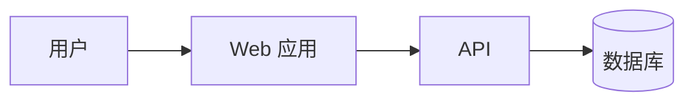
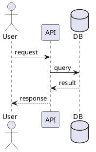
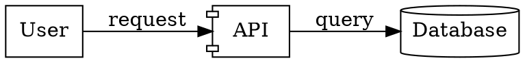
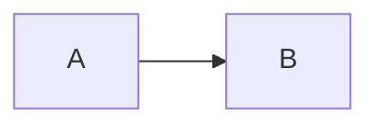

# Software diagrams as code

用“先澄清模型，再选择最合适的 DSL，生成可审阅源码，最后渲染和验证”的流程绘制软件工程图。默认保留图表源码；图片只是可再生成的产物。

宿主安装和平台差异请按需阅读 [references/compatibility.md](references/compatibility.md)。`SKILL.md` 是跨模型的核心工作流；`agents/openai.yaml`、`CLAUDE.md` 和 `AGENTS.md` 只是不同宿主的入口或元数据，不要复制出多份独立工作流。

## 工作流

1. **识别图的目的和受众**
   - 先确认要表达的是结构、行为、数据、部署、流程还是项目计划。
   - 确定抽象层级：系统上下文、容器、组件、类、实例或代码级细节。
   - 记录方向、布局、主题、语言、输出格式、尺寸和是否需要可编辑源文件。
2. **选择 DSL**
   - 根据下方决策表选择工具；不要为了统一而强行使用同一种语法。
   - 如果一个工具无法自然表达需求，切换工具，并说明选择原因。
3. **生成源码**
   - 先生成最小可读版本，再补充样式、边界、注释和细节。
   - 节点和关系使用稳定、语义化的 ID；显示文本可单独修改。
   - 长图拆成多个视图或子图，避免一张图承担多个叙事目标。
4. **渲染和验证**
   - 优先在本地调用相应 CLI 或编辑器渲染。
   - 验证语法、节点是否遗漏、箭头方向、图例、字体、边界、可读性和文件路径。
   - 失败时先修源码再重渲染，不要手工修改生成的 SVG/PNG。
5. **交付**
   - 将源码放在项目的文档或 diagrams 目录，图片放在 assets/diagrams 或用户指定位置。
   - Markdown 用相对路径引用；LaTeX 优先引用 SVG/PDF 或转换后的 PNG。
   - 同时交付源码和渲染产物时，确保文件基名一致，例如 `context.mmd` 与 `context.svg`。

## 可复现渲染工具链

优先把渲染器固定在项目内，不依赖开发机的全局 PATH。推荐在项目中使用类似下面的目录：

```text
tools/
  package.json
  package-lock.json
  render-all.ps1
  render-wasm.mjs
  node_modules/
    @hpcc-js/wasm-graphviz/
    @terrastruct/d2/
    drawio-headless/
  bin/
    plantuml.jar
    structurizr/
      structurizr.bat
      lib/
```

已验证的 Windows 调用方式：

| 工具 | 推荐安装/存放 | 调用方式 |
|---|---|---|
| Mermaid CLI | 项目依赖或 npx 缓存；生产/CI 应固定到项目依赖 | `npx @mermaid-js/mermaid-cli -i diagram.mmd -o diagram.svg` |
| PlantUML | 项目内 `tools/bin/plantuml.jar`；需要 Java | `java -jar tools/bin/plantuml.jar -tsvg diagram.puml` |
| Structurizr CLI | 项目内 `tools/bin/structurizr/` | `tools/bin/structurizr/structurizr.bat validate -w architecture.dsl`，再用 `export` 导出视图源码 |
| D2 | 项目内 npm 包 `@terrastruct/d2`，通过 WASM 脚本调用 | `node scripts/render-wasm.mjs` |
| Graphviz | 项目内 npm 包 `@hpcc-js/wasm-graphviz`，通过 WASM 脚本调用 | `node scripts/render-wasm.mjs` |
| draw.io | 项目内 npm 包 `drawio-headless`；二进制在该包的 `vendor/` | `npm exec -- drawio-headless render input.drawio output.svg` |

本地实测位置示例：

```text
tools/bin/plantuml.jar
tools/bin/structurizr/structurizr.bat
node_modules/@hpcc-js/wasm-graphviz/
node_modules/@terrastruct/d2/
node_modules/drawio-headless/
```

`npx --yes @mermaid-js/mermaid-cli` 会把 Mermaid CLI 放进用户 npm 缓存的 `_npx` 临时目录；该目录可能因缓存清理或版本变化而改变，不能作为项目的稳定依赖。需要 CI、离线构建或团队复现时，把 `@mermaid-js/mermaid-cli` 加入项目 `devDependencies`，并从项目的 `node_modules/.bin/mmdc` 调用。

不要把 D2 和 Graphviz 的 WASM 包误当成系统级 `d2`/`dot` 命令；它们需要由 Node 脚本加载并写出 SVG。若项目已经安装原生 `dot` 或 `d2`，可以直接使用，但仍应在文档中记录版本和 fallback。

Structurizr DSL 的 `theme default` 可能触发对 `static.structurizr.com` 的远程访问。离线或受限网络环境下，先移除远程 theme，运行 `validate`，再用 `export -f plantuml` 导出 PlantUML 视图并继续本地渲染。

draw.io XML 不是图片；始终保留 `.drawio`/`.xml` 源码。需要图片时使用 diagrams.net 或 `drawio-headless` 导出 SVG/PNG，并对导出的图片做一次视觉检查。

## 一键重建和验证

如果项目已有统一脚本，优先执行它而不是手工运行多个命令：

```powershell
& .\scripts\render-all.ps1
```

脚本应按以下顺序工作：渲染 Mermaid；运行 PlantUML；验证并导出 Structurizr；渲染 D2/Graphviz WASM；导出 draw.io SVG/PNG；最后列出所有输出文件。脚本遇到任何渲染错误都应返回非零退出码。

## 工具决策表

| 工具 | 优先场景 | 输出/特点 |
|---|---|---|
| Mermaid | Markdown 内嵌流程图、时序图、类图、状态图、ER 图、甘特图、用户旅程 | `.mmd`；浏览器、Mermaid CLI、Markdown 渲染器支持广 |
| PlantUML | UML 图、复杂时序图、组件/部署图、注重自动布局的文档 | `.puml`；可输出 SVG、PNG、PDF，适合 Java/UML 生态 |
| Structurizr DSL | C4 模型、软件架构视图、多个层级的一致模型 | `.dsl`；从一个模型生成多个架构视图 |
| D2 | 现代架构图、流程图、需要较强布局和主题控制的图 | `.d2`；适合导出 SVG/PNG |
| Graphviz DOT | 图算法、依赖图、调用图、状态/关系网络、可控布局 | `.dot`；通过 `dot`/`neato`/`fdp` 等引擎导出 |
| draw.io XML | 需要在 diagrams.net 中继续手工编辑、交付给非开发者 | `.drawio`/`.xml`；应保留可编辑 XML |

## 常见选择规则

- **C4 架构**：优先 Structurizr DSL；只需要在 README 中展示时可用 Mermaid。
- **UML 时序、组件、部署**：优先 PlantUML；简单时序可用 Mermaid。
- **流程和交互叙事**：优先 Mermaid 或 D2。
- **依赖、调用、拓扑关系网络**：优先 Graphviz DOT；节点很多时选择合适布局引擎。
- **需要拖拽后续编辑**：输出 draw.io XML，并避免只交付截图。
- **同一模型需要多个视图**：优先 Structurizr DSL 或维护单一数据源后生成多个 DSL 文件。

## 建模约定

- 节点命名表达领域概念，ID 使用 ASCII、稳定且不含空格。
- 明确箭头含义：调用、依赖、数据流、继承、部署、拥有关系不要混用同一种线型。
- 用颜色表达有限且稳定的语义，例如系统边界、外部系统、数据库、异步消息；提供图例。
- 不要仅靠颜色传达信息；同时使用文字、线型或形状。
- 时序图标明参与者和消息方向；状态图标明初始状态、终止状态和转移条件。
- 架构图标出信任边界、运行边界、数据存储和关键协议；避免把实现细节塞进高层视图。
- 关系标签简短，必要时在正文解释缩写和协议。

## 源码模板

### Mermaid



保存为 `diagram.mmd`；命令行渲染示例：

```bash
npx @mermaid-js/mermaid-cli -i diagram.mmd -o diagram.svg
npx @mermaid-js/mermaid-cli -i diagram.mmd -o diagram.png -b transparent
```

### PlantUML



保存为 `diagram.puml`；需要本地 PlantUML/JAR 或项目已有渲染脚本。输出 SVG 优先用于文档，PNG 用于不支持矢量图的环境。

### Structurizr DSL

```text
workspace {
    model {
        user = person "User"
        system = softwareSystem "Order system" {
            web = container "Web app"
            api = container "API"
            db = container "Database" "Stores orders" "PostgreSQL"
        }
        user -> system "Uses"
        web -> api "Calls"
        api -> db "Reads and writes"
    }
    views {
        container system {
            include *
            autolayout lr
        }
    }
}
```

优先把领域模型定义一次，再创建 context/container/component 等视图；避免在每个视图中复制不同的关系描述。

### D2

```d2
user: User
web: Web app
api: API
db: Database {
  shape: cylinder
}
user -> web: Uses
web -> api: Calls
api -> db: Reads/writes
```

### Graphviz DOT



渲染示例：`dot -Tsvg diagram.dot -o diagram.svg`；关系网络可尝试 `neato`、`fdp`、`sfdp` 或 `circo`。

### draw.io XML

只有在用户需要 diagrams.net 可编辑文件时直接生成 XML。保持标准 `<mxfile>`、`<diagram>`、`<mxGraphModel>` 结构；使用唯一 cell ID、父子层级和几何坐标。交付前用 diagrams.net 打开并检查连线锚点、分组和文本，不要把 XML 当作图片格式。

## Markdown、LaTeX 和其他工具

### Markdown

优先使用源码代码块，以便文档平台原生渲染：

````markdown

````

若平台不支持 Mermaid，引用已渲染图片：

```markdown

```

### LaTeX

图片引用：

```latex
\begin{figure}[htbp]
  \centering
  \includesvg[width=0.9\linewidth]{assets/diagrams/context}
  \caption{系统上下文图}
  \label{fig:context}
\end{figure}
```

如果编译环境不支持 `svg`，使用 PDF/PNG：

```latex
\includegraphics[width=0.9\linewidth]{assets/diagrams/context.pdf}
```

### 其他绘图软件

- draw.io：导入 `.drawio`/`.xml`，继续拖拽编辑，再导出 SVG/PNG/PDF。
- Figma、Inkscape、Illustrator：优先导入 SVG；需要编辑路径时保留一份原始 SVG。
- Word/PowerPoint：优先插入 SVG；若兼容性不足再使用高分辨率 PNG。
- CI 文档：把源码作为构建输入，把图片放在构建目录，禁止只提交手工导出的孤立截图。

## 文件组织

推荐结构：

```text
docs/
  diagrams/
    context.mmd
    context.svg
    sequence.puml
    sequence.svg
    architecture.dsl
    architecture.drawio
```

按项目约定调整目录；源码、渲染图片和文档引用的相对路径必须一致。

## 质量检查清单

- 图的目的、层级和受众是否明确？
- DSL 是否适合该图，且能被项目工具链渲染？
- 源码是否可读、可维护、可再次生成？
- 关系方向、标签、协议、边界和图例是否正确？
- 渲染后是否没有裁切、重叠、乱码或过小文字？
- Markdown/LaTeX 的引用路径是否相对当前文件正确？
- 是否同时提供用户需要的源码和 PNG/SVG 等产物？
- 变更后是否说明渲染命令和所需依赖？

## 交互默认值

当用户只说“画一个图”时，先根据上下文推断图类型；若仍有歧义，提出最多一个关键问题，同时可以先给出一版合理草图。默认：

- 架构图使用 Structurizr DSL 或 Mermaid；
- 文档内嵌使用 Mermaid 源码；
- 独立交付使用 SVG，并保留 DSL 源码；
- 需要编辑使用 draw.io XML；
- 需要论文级排版时优先 SVG/PDF，并提供 LaTeX 片段。
