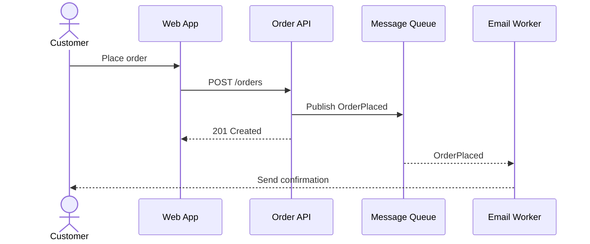

# Software diagrams demo

This gallery exercises `skills/software-diagrams/SKILL.md`. It uses one fictional Shop system to keep names and relationships consistent. Every entry has editable source; XML diagrams can be opened in diagrams.net.

## Gallery

| Format | Diagram | Source |
|---|---|---|
| Mermaid | Order request sequence | [source](sources/mermaid-sequence.mmd) · [SVG](rendered/mermaid-sequence.svg) |
| Mermaid | Order state machine | [source](sources/mermaid-state.mmd) · [PNG](rendered/mermaid-state.png) |
| PlantUML | Domain class model | [source](sources/plantuml-class.puml) · [SVG](rendered/plantuml-class.svg) |
| PlantUML | Deployment view | [source](sources/plantuml-deployment.puml) · [SVG](rendered/plantuml-deployment.svg) |
| Structurizr DSL | C4 context and container views | [source](sources/structurizr-shop.dsl) · [context SVG](rendered/structurizr-context.svg) · [containers SVG](rendered/structurizr-containers.svg) |
| D2 | Service architecture | [source](sources/d2-architecture.d2) · [SVG](rendered/d2-architecture.svg) |
| D2 | Checkout flow | [source](sources/d2-checkout.d2) · [SVG](rendered/d2-checkout.svg) |
| Graphviz DOT | Service dependencies | [source](sources/graphviz-dependencies.dot) · [SVG](rendered/graphviz-dependencies.svg) |
| Graphviz DOT | Order state transitions | [source](sources/graphviz-states.dot) · [SVG](rendered/graphviz-states.svg) |
| draw.io XML | Editable service architecture | [source](sources/drawio-architecture.drawio) · [SVG](rendered/drawio-architecture.svg) |
| draw.io XML | Editable checkout flow | [source](sources/drawio-checkout.drawio) · [PNG](rendered/drawio-checkout.png) |

### Mermaid sequence preview



### D2 architecture preview

```d2
direction: right
customer: Customer { shape: person }
web: Web App
api: Order API
db: Order DB { shape: cylinder }
queue: Message Queue { shape: queue }
worker: Email Worker
customer -> web: HTTPS
web -> api: JSON
api -> db: SQL
api -> queue: publish
queue -> worker: consume
```

## Render commands

The complete local pipeline is:

```powershell
& .\scripts\render-all.ps1
```

It validates Structurizr, exports its C4 views to PlantUML, renders every source, and writes the image outputs into `examples/shop/rendered/`. The project-local WASM dependencies are in the repository root `package.json`.

For individual tools, use the following commands from the repository root. The gallery helper for D2 and Graphviz is intentionally fixed to these example files:

```bash
npm exec -- mmdc -i examples/shop/sources/mermaid-sequence.mmd -o examples/shop/rendered/mermaid-sequence.svg
node scripts/render-wasm.mjs
npm exec -- drawio-headless render examples/shop/sources/drawio-architecture.drawio examples/shop/rendered/drawio-architecture.svg
```

For PlantUML, use the full gallery command so generated files are moved from `sources/` into `rendered/`:

```powershell
pwsh ./scripts/render-all.ps1
```

Open the `.drawio` files in diagrams.net and use **File → Export as** to produce SVG, PNG or PDF. Keep the XML alongside the export as its editable source.

Use a Mermaid block as the canonical source when the document is meant to own the diagram. If the editable source is a separate file, reference its rendered image instead, e.g. ``. For LaTeX, render SVG/PDF and include with `\includesvg` or `\includegraphics`.

## Expected outputs

After a successful gallery render, generated outputs include:

- Mermaid: `mermaid-sequence.svg`, `mermaid-state.png`
- PlantUML: `plantuml-class.svg`, `plantuml-deployment.svg`
- Structurizr DSL: `rendered/structurizr-context.svg`, `rendered/structurizr-containers.svg`
- D2: `d2-architecture.svg`, `d2-checkout.svg`
- Graphviz DOT: `graphviz-dependencies.svg`, `graphviz-states.svg`
- draw.io XML: `drawio-architecture.svg`, `drawio-checkout.png`

The PNG outputs were opened for visual inspection after rendering. The SVG outputs are available for Markdown, LaTeX, Figma, Inkscape, Word and PowerPoint workflows. The `.drawio` files remain the editable source of the draw.io exports.
